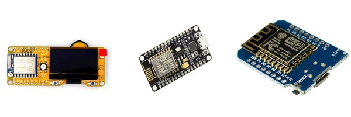
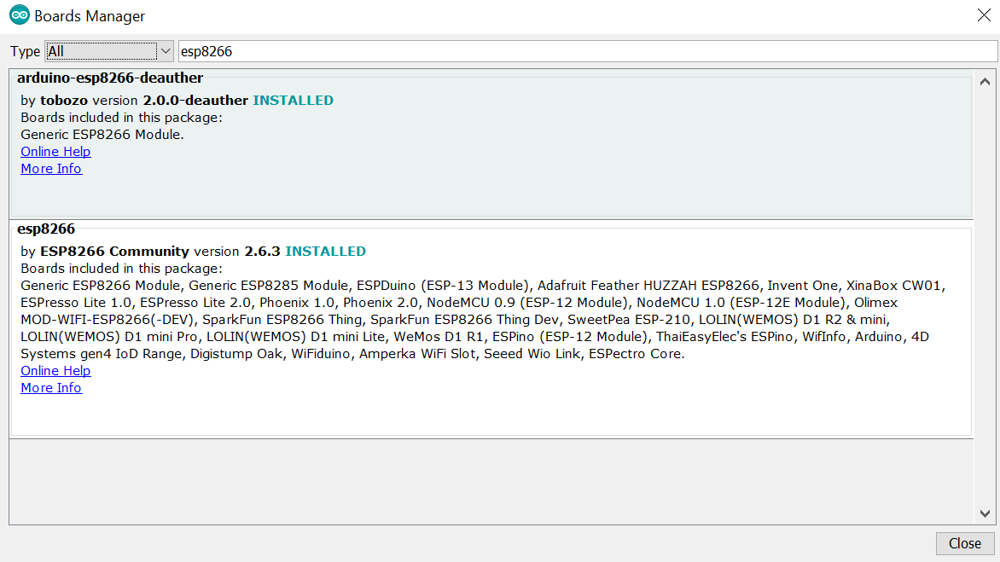
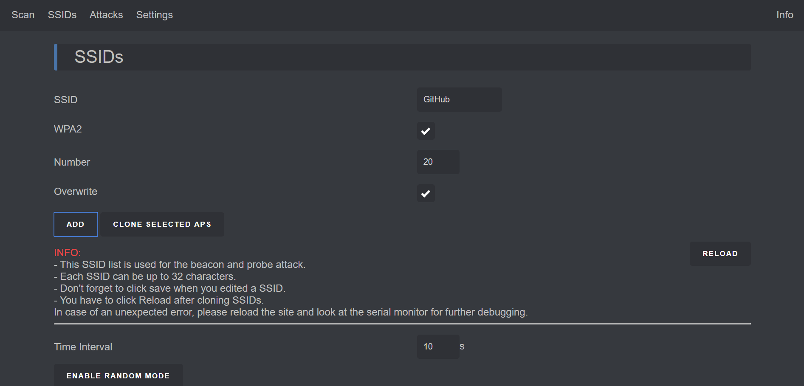
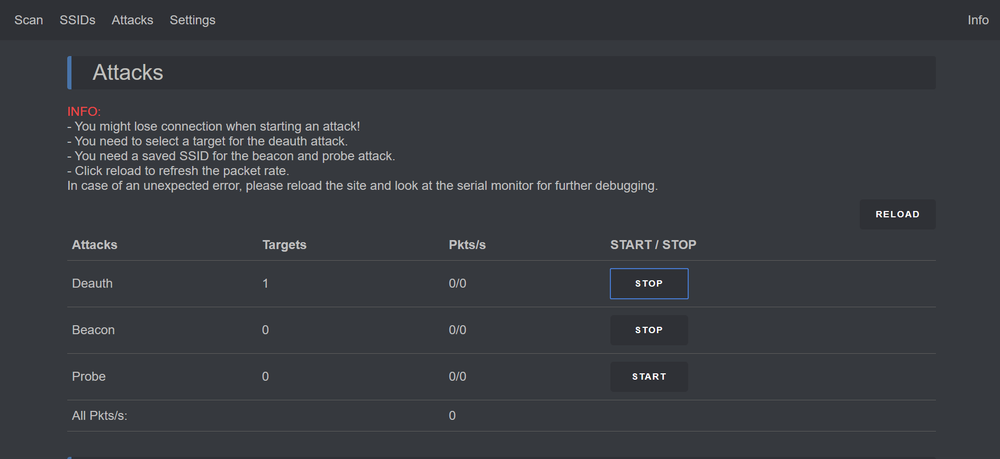
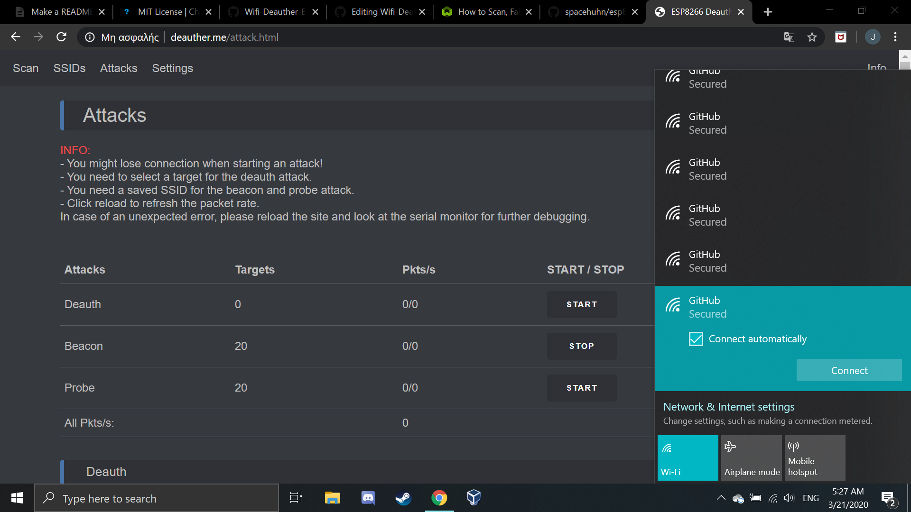

# ESP8266 Wi-Fi Deauther: Tutorial
Thorough and simple tutorial on the WiFi Deauther using an ESP8266 board. Based on the work of Stefan Kremser ([spacehuhn](https://github.com/spacehuhn)), used to launch deauthentication, beacon and other attacks on WiFi networks.

> [!CAUTION]
> Using the WiFi Deauther on networks you don't own is illegal.

## Hardware Prerequisites

### Suitable boards
> [!WARNING]
> Note that there are multiple knock-off boards you can use, however there's always a risk of them not being suitable.

- **DSTIKE WiFi Deauther MiNi ESP8266 OLED**: Already configured board, features a screen that enables its use without the need of it being plugged into a laptop or smartphone.
- **ESP8266 NodeMcu with CP2102** or **ESP8266 NodeMcu with CH340G**: The first one is probably the best choice for this tutorial.
- **WeMos D1 Mini ESP8266 NodeMcu 4M**: Generally most WeMos ESP8266 boards will work, even if they are knock-offs.

<p align="center"></p>

> In order: DSTIKE WiFi Deauther MiNi ESP8266 OLED, ESP8266 NodeMcu with CP2102, WeMos D1 Mini ESP8266 NodeMcu 4M.

### Cables needed

All boards (except the DSTIKE WiFi Deauther MiNi ESP8266 OLED) need to be connected with a micro-USB cable to a power source, such as a laptop, smartphone, or power bank.

## Programming the board
> [!NOTE]
> If using the DSTIKE WiFi Deauther MiNi ESP8266 OLED skip this step.

To use the ESP8266 board, we will need to program it. In order to do that, we will need to download the Arduino IDE (found here: [Arduino IDE](https://www.arduino.cc/en/Main/Software)).

> [!TIP]
> Use the Arduino IDE and not Arduino Web Editor.

After installing Arduino IDE, open it and head to the Navigation Bar. Select `File > Preferences` (or `Arduino > Preferences`) and paste the following links in the "Additional Boards Manager URLs" field:

```text
http://arduino.esp8266.com/stable/package_esp8266com_index.json
http://phpsecu.re/esp8266/package_deauther_index.json
```
> [!NOTE]
> Make sure they are on separate lines and apply the changes clicking "OK".

Navigate to `Tools > Board > Boards Manager`, search for `esp8266`, and install both `arduino-esp8266-deauther` and `esp8266` (if `esp8266` is already installed, make sure it is updated to the latest version). Once complete, both entries will display **INSTALLED** next to their names.

<p align="center"></p>

Connect the board to your computer with a micro-USB cable and open the `Tools` menu:
1. Under `Tools > Board > ESP8266 Deauther Modules`, select your specific board model.
2. Check `Tools > Port` to confirm a COM port (Windows) or `/dev/cu...` port (macOS) is selected. If no port appears, you likely need to install the CP2102 or CH340G USB-to-serial driver for your board.

> [!TIP]
> For ESP8266 boards with the CP2102 chip, changing `Tools > Upload Speed` to `115200` helps prevent upload errors.

Next, download the Deauther firmware source code:

For Linux users:
```shell
git clone https://github.com/spacehuhn/esp8266_deauther.git
```

For Windows/Mac users:

Head to [esp8266_deauther repository](https://github.com/spacehuhn/esp8266_deauther.git), click `Code > Download ZIP`, and extract the `esp8266_deauther-master` archive.

### Final Steps
1. Copy the entire `esp8266_deauther-master/esp8266_deauther` folder (not just the `.ino` file) into your `Documents > Arduino` folder.
2. Open `esp8266_deauther.ino` inside that folder using Arduino IDE (this will load all companion files as tabs).
3. Click **Upload** (the right-pointing arrow below the top menu bar) and wait for the upload to finish.

Your board is set up and ready to use.


## Connecting to the board network
Power the board via micro-USB using a laptop, smartphone or power bank. Once powered on, open your device's Wi-Fi settings and connect to the network named `pwned` using the password `deauther`. Open a browser and navigate to `deauther.me` or `192.168.4.1` to load the control panel:

<p align="center"></p>

Agreeing with the warning given to you grants you permission to the interface through which the attacks will be executed (shown below).

<p align="center"></p>

## Using the network and attacking

The interface consists of four pages, Scan, SSID, Attacks and Settings.

### Scan
The Scan page is divided into three sections: **Access Points** (nearby Wi-Fi routers), **Stations** (connected client devices), and **Saved Devices**.

Click **Scan APs** to detect nearby networks, or **Scan Stations** to find connected devices. Once the scan finishes, check the box next to the target Access Point or Station you want to test before moving to the Attacks tab.

### SSID
> [!NOTE]
> Fake networks created during an attack may remain visible in device Wi-Fi lists for a short time after you stop the attack.

The SSID page lets you generate fake network names for Beacon and Probe attacks using four fields:
- **SSID**: The base network name used for the fake networks.
- **WPA2**: Checkbox that makes the fake networks appear password-protected instead of open.
- **Number**: How many fake networks to generate (up to 60).
- **Overwrite**: Checkbox that replaces your current SSID list instead of appending to it.

<p align="center"></p>

> Example of generating 20 WPA2-enabled fake Wi-Fi networks named "GitHub".

### Attacks

#### Deauth Attack
A Deauth Attack disconnects devices from a Wi-Fi network by flooding the router and client with deauthentication frames. This works on networks and devices that do not enforce the `802.11w-2009` (Protected Management Frames) standard.

1. Select your target Access Point or Station on the **Scan** page.
2. Open the **Attacks** page and click **Start** next to **Deauth**.

> [!IMPORTANT]
> Select only one target at a time, as selecting multiple targets can cause stability bugs.

<p align="center"></p>

#### Beacon Attack
Beacon packets are the signals routers broadcast to advertise their Wi-Fi network names. By continuously transmitting fake beacon packets, the ESP8266 makes nearby devices see dozens of phantom Wi-Fi networks.

1. Generate your list of fake network names on the **SSID** page.
2. Open the **Attacks** page and click **Start** next to **Beacon**.

> [!TIP]
> Customize the fake network names on the **SSID** page before starting the attack.

<p align="center"></p>

#### Probe Attack
Client devices (like smartphones) constantly broadcast probe requests asking if previously saved Wi-Fi networks are nearby. A Probe Attack mimics this behavior using the names in your **SSID** list, which confuses passive Wi-Fi tracking systems and analytics sniffers.

> [!NOTE]
> This attack targets passive Wi-Fi trackers rather than routers, so you will not see any visible effect on your home network.

### Settings
On the **Settings** page, you can customize the Deauther's own Wi-Fi hotspot—including its network name (`pwned`), password (`deauther`), and web interface behavior.

> [!TIP]
> Change the default hotspot name and password right away so others cannot connect to your board. After saving, reconnect your device using the new Wi-Fi credentials.
